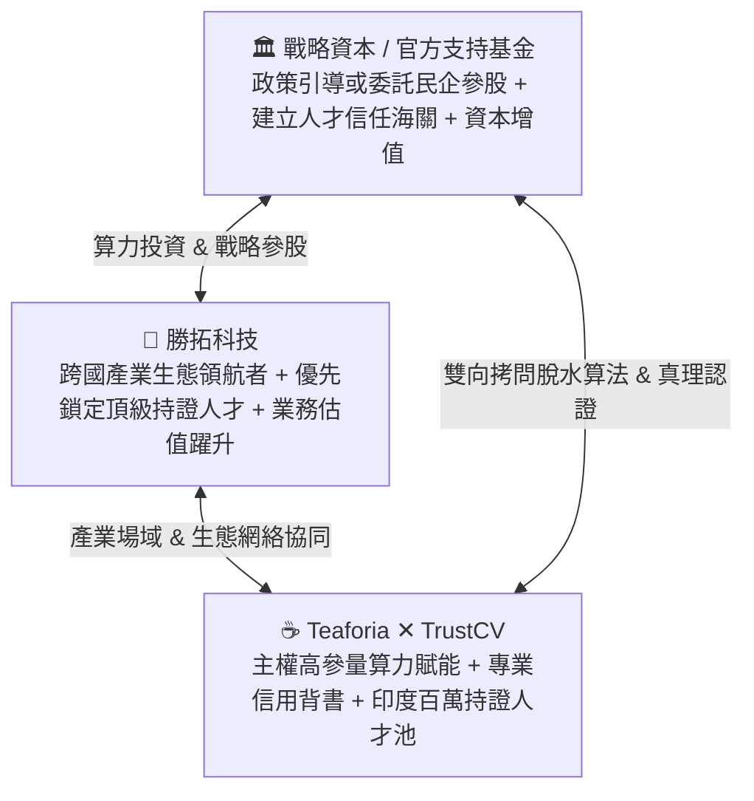

# 【專案戰略倡議書】台印跨國高階技能人才真理中樞：勝拓 ✕ 印度 Teaforia (TrustCV) 算力擴建與戰略資本協同計畫

> **專案代號**：`TrustCV-Global-2026`  
> **發起主導方**：勝拓科技股份有限公司（Sheng Tuo Technology）  
> **核心技術方**：印度 Teaforia ✕ TrustCV 國際團隊  
> **戰略合作方**：政策性引導基金 / 官方委託機構 / 戰略產業資本  
> **平台本體**：TrustCV 跨國就業與履歷真理平台（`cv.teaforia.in`）

---

## 一、 執行摘要（Executive Summary / BLUF）

### 1. 核心定位與戰略主張
本專案由具備深厚產業與政商協同網絡之**勝拓科技**，攜手深耕印度之 **Teaforia ✕ TrustCV** 技術團隊，並**邀請政策性戰略資本（包括政府引導基金、官方委託之公信力民企或產業戰略投資人）共同參股與算力協同**，將 TrustCV（`cv.teaforia.in`）升級為**「台印跨國高階專業技能人才 ✕ 企業職缺雙向真理中樞」**。

### 2. 嚴格邊界守門：只做「具備專業門檻的硬技能與持證人才」
本平台**絕不做低技術門檻之非技能純勞力仲介**，而是瞄準台灣跨國產業與外資在台最痛的「高階專業技術斷崖」：
* **半導體製造與封測工程師**（製程、設備、封裝測試）
* **精密電子與電機製造工程師**（硬體、電路、自動化產線）
* **軟體與 AI 演算法工程師**（雲端、全端、大模型推理微調、韌體）
* **土木機電與建廠營造工程師**（高科技廠房營造、機電管線整合）
* **跨國溝通高階管理與國際銷售精英**（雙語商務拓展、跨國專案管理 PM）
* **持證專業技術人才**（具備國際執照之專業護理、專業技師等合規專業人才）

---

## 二、 一頁紙核心指標與利益對齊

| 核心維度 | 現狀跨國招聘之混亂痛點 | TrustCV 雙向真理中樞解法 | 為各方創造之實質回報 |
| :--- | :--- | :--- | :--- |
| **人才資格真偽** | **AI 假履歷與假證照泛濫**：ChatGPT 批量虛構經歷，視訊代考，踩雷一次損失上百萬。 | **高參量 AI 雙向極限壓力對抗拷問**：深度驗證理論極限、代碼實測、執照專業問答，水分剔除率 >95%。 | **阻絕劣幣逐良幣**：保障台灣企業用人品質，降低 60% 以上海外招募試錯成本。 |
| **職缺真實性** | **跨國幽靈職缺與詐騙**：不良仲介與虛假公司收割海外人才個資，引發跨國勞資糾紛。 | **企業崗位與薪酬合規探針**：雙向審計職缺真實性、勞動法規與薪酬水準。 | **保護跨國公信力**：樹立合規、乾淨的台印國際專業人才對接通道。 |
| **人才庫規模** | **收費牆封閉**：傳統平台逐筆向工程師收費，高階人才意願低，履歷破碎過期。 | **動態 CV 永久免費託管**：工程師免費版本化託管職業資產，形成龐大自然流量池。 | **掌握百萬專業人才池**：為台企出海與在台外資建立隨選即用的真實技術大腦。 |
| **資本與回報** | **一次性補助消耗**：傳統補助案結案即終止，缺乏自體獲利循環。 | **戰略股權參股（多元資本協同）**：政策性引導基金或受託民企持股，隨平台高速擴張享有分紅與 IPO 資本利得。 | **股權增值與公私共贏**：以市場化高毛利 SaaS/算力變現模式，創造可持續財務回報。 |

---

## 三、 為什麼需要升級高參量算力？

印度頂尖求職者背後有 GPT-4o、Claude 等強大大模型輔助作弊與背題庫。若 TrustCV 只用 7B 邊緣小模型，無法在多輪跨領域技術對話中精準辨別真偽。  
**必須導入 70B+ 專家混合模型集群（MoE）**，具備長上下文記憶與專業工程邏輯圖譜，才能建立**「比作弊者更聰明的 AI 專業考官」**，為跨國企業守住品質第一道防線！
