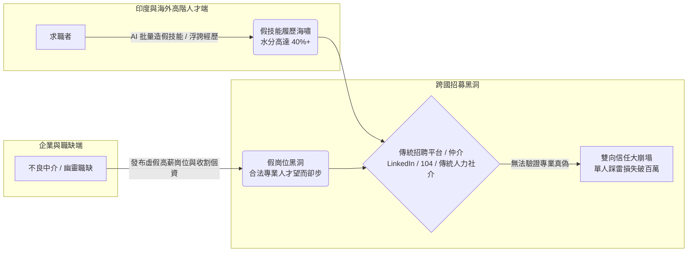

# 【市場痛點與戰略危機】跨國高階技能招募的「雙向信任大崩塌」與台灣各界用人死穴

> 檔案識別：`01_MARKET_PAIN_TRUST_CRISIS.md`  
> 核心受眾：經貿與產發審查長官、產業戰略投資人、勝拓決策層  
> 核心主張：**「AI 時代的跨國高階招募正面臨前所未有的雙向信任真空：求職者用 AI 批量造假技能，黑心仲介用幽靈職缺收割，而企業在中間承擔高昂的踩雷代價。」**

---

## 一、 現實困境：跨國專業技能市場的「檸檬市場（劣幣逐良幣）」

隨著全球高科技製造、數位軟體與公共建設的迅速擴張，台灣企業面臨嚴峻的人力斷層。然而，台灣與印度之間的跨國人才對接，表面上需求極其迫切，實則陷入了嚴重的**信任阻絕**：

---

## 二、 本專案嚴格界定：只做「具備專業門檻的硬技能與持證人才」

**我們絕不做、也堅決反對任何無技術門檻的純基層勞工仲介！**  
台灣真正缺乏的是具備紮實專業訓練與國際證照的**高門檻技術支柱**：

| 目標專業領域 | 台灣產業痛點與剛需特徵 | 印度人才供給優勢 | 傳統招募之最大風險 |
| :--- | :--- | :--- | :--- |
| **半導體晶圓製造 / 封測工程師** | 製程整合 (PIE)、設備維護、封裝測試 (Packaging/Testing)，本土理工人才供不應求。 | 印度頂尖理工學院 (IIT/NIT) 大量具備晶片物理、材料與封裝背景之工程碩博士。 | 靠 AI 背題庫，入廠後無法獨立進行機台調校與產線異常排查。 |
| **精密電子電機製造 / 代工工程師** | 產線自動化、機構設計、PCB/SMT 測試工程師嚴重短缺。 | 龐大的硬體電氣工程師儲備，英語溝通無障礙，具備跨國工廠除錯經驗。 | 履歷灌水，聲稱懂自動化 PLC，實際上線連基本電路圖都讀不懂。 |
| **軟體開發 / AI 演算法工程師** | 雲端架構、後端高併發、LLM 模型微調、嵌入式 Linux 韌體開發人才極度稀缺。 | 全球最大的軟體工程智力庫，開源社群活躍，代碼能力具全球競爭力。 | 靠 AI 實時輔助代寫代碼、替考，入職後無法應對高壓架構重構。 |
| **土木機電 / 廠房營造工程師** | 科技廠房擴建、海外建廠、土木結構、無塵室機電管線整合人才大斷層。 | 豐富的跨國基建與工業廠房施工管理經驗，成本效益顯著。 | 假工程經歷，缺乏大型工廠管線耐震、安全規章實務判斷能力。 |
| **跨國高階管理 / 國際銷售精英** | 台灣企業出海拓展美歐印市場，急需雙語流利、懂國際商務法規的專案經理 (PM) 與銷售專家。 | 擅長跨文化溝通與國際客戶開拓，深諳跨國商業談判與供應鏈對接。 | 英語流利但缺乏實質業績，以包裝話術騙取高額底薪。 |
| **持證專業人員 (護理 / 專項技術)** | 醫療院所護理師、高階長照持證護士、專業檢驗技師面臨高齡化缺口。 | 嚴格英制醫療護理訓練體系，擁有國際認證護理執照 (RN/BSN)。 | 執照造假或偽造臨床實習經驗，造成醫療照護與法律重大風險。 |

---

## 三、 痛點深水區：AI 氾濫時代的「假履歷海嘯」

### 1. 專業經歷造假零門檻
在 ChatGPT 與各類生成式 AI 工具普及後：
* 任何求職者都能在幾秒內產生針對目標職缺量身打造的「全端/製程專家級簡歷」。
* 虛構大型工程專案與臨床經驗，專有名詞精準，甚至偽造過往公司的推薦信與工作證明。
* 視訊面試時使用實時提詞工具，對答如流。

### 2. 跨國踩雷代價高達數百萬
跨國招聘一名專業工程師或主管，企業需承擔：
* 跨國簽證、搬遷補貼、前期安置費用；
* 3 個月試用期的薪資與內部工程導師時間消耗；
* **單一人才踩雷直接財務損失達 NT$ 120 萬至 180 萬元！**
* 更致命的是「專案時程延誤」與「安全/品管失誤」帶來的無形損失。

---

## 四、 跨國黑洞：假職缺、幽靈崗位與不良仲介的剝削

* **幽靈職缺（Ghost Jobs）**：國際平台上超過 30% 職缺為虛構或已凍結，不良仲介藉此收集海外高階人才個資。
* **高額抽成剝削**：傳統仲介向企業收取高達年薪 25%~30% 的獵頭費，同時暗中向求職者收取高額押金或抽成，導致海外真正優秀的持證人才極度不信任跨國招募管道。

---

## 五、 結論：現狀必須被「客觀中立的 AI 雙向真理中樞」終結

台灣需要的不僅僅是招募廣告網站，而是一座具備**「雙向對抗驗證」**與**「真實資產託管」**的跨國信用橋樑，讓有真才實學的持證人才與真正開出優質職缺的企業，在透明、公平的環境下精準互信對接。
