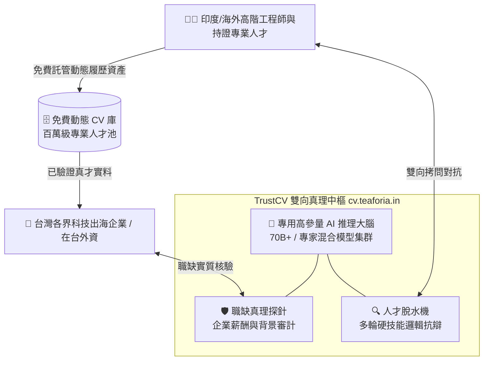

# 【破局產品定位】TrustCV 雙向真理中樞：以高參量 AI 算力重構跨國專業技能信用底座

> 檔案識別：`02_SOLUTION_TRUSTCV_CORE.md`  
> 核心受眾：產學研科技審查委員、戰略投資人、產業界技術主管  
> 核心主張：**「TrustCV（cv.teaforia.in）不是普通人力仲介網站，而是全球首座具備『雙向抗辯審計』與『動態資產託管』的跨國技能真理中樞。」**

---

## 一、 產品定位：什麼是 TrustCV？

TrustCV 徹底拋棄傳統「上傳 PDF 靜態履歷 ➔ 關鍵字匹配 ➔ 人工碰運氣面試」的過時流程，透過自主研發的 AI 架構建立雙向信任閉環：



---

## 二、 核心殺手鐧之一：智能雙向極限對抗拷問（The Dual-Interrogation Engine）

不同於市面上單向錄影評分或做選擇題的「假 AI 面試」，TrustCV 採用的是**「主考官 ✕ 破綻偵測」雙向博弈架構**：

### 1. 人才端：「硬技能高壓脫水機」——擊破 AI 代面試與背題庫
* **動態連環深水區追問**：  
  當求職者聲稱具備「製程除錯」、「AI 模型微調」或「高階護理急救」經驗時，AI 考官不會問標準書本題目，而是連續拋出邊界異常情境：
  * *半導體/電子*：「當測試良率在特定高溫步階突發 15% 跌幅，你的根本原因排查矩陣如何建立？」
  * *軟體/AI*：「在每秒 5 萬次查詢的尖峰延遲下，你的快取穿透防禦在分散式資料庫節點中如何保持事務一致性？」
  * *專業持證*：「遇到複雜急性過敏反應且合併心律不整時，你的臨床給藥優先順序與急救處置依據為何？」
* **前後矛盾偵測（Contradiction Probing）**：  
  在對話推進至第 8~12 輪時，AI 考官會主動交叉比對受測者在前期提出的論點。靠提詞器或大模型代答者，無法在多輪高壓壓力下保持自洽，破綻捕捉率高達 95% 以上。
* **即時代碼沙盒與實操驗收**：  
  直接在瀏覽器端注入帶有實際瑕疵的代碼或架構圖，現場考驗排查邏輯，徹底終結「面試滿分、上線抓瞎」。

### 2. 職缺端：「企業崗位與薪酬合規探針」——杜絕幽靈崗位與跨境詐騙
**雙向拷問的關鍵在於：AI 同樣會嚴格拷問招募方！**
* **職務可行性審計**：AI 自動質疑企業所開出的職務內容與薪資是否具備合理性、是否符合兩國勞動法規。
* **企業真實營運背調**：驗證企業合法性、過往跨國招募信譽，杜絕空殼公司與個資收割行為。
* **效益**：讓海外真正優秀的工程師與專業人士 100% 確信，通過 TrustCV 考驗後對接的是真實、有保障的優質雇主。

---

## 三、 核心殺手鐧之二：動態 CV 永久免費託管（Professional Asset Vault）

要匯聚海外百萬頂尖專業人才，絕不能靠向求職者收費，而是提供極致的免費工具價值：

* **「工程師與專業人士的履歷 GitHub」**：個人用戶在 TrustCV 終生免費託管自己的動態技能樹、專案紀錄與專業執照驗證。
* **密碼學防偽 Trust Badge**：完成極限對抗考核者，將獲頒具備防偽特徵的客觀能力評鑑報告。求職者可直接將徽章外鏈至個人網頁與社群，引發海外技術圈的病毒式口碑傳播。
* **流量黑洞效應**：當海外專業人才把 TrustCV 當作必備的職業信用資產庫時，平台便自然沉澱龐大的真實高素質人才池。

---

## 四、 為什麼必須升級「主權級高參量算力」？

向戰略資本或審查機構爭取算力預算的核心邏輯：**這是一場認知能力的攻防軍備競賽！**

```text
作弊求職者身後站著：GPT-4o / Claude 3.5 Sonnet 等巨型大模型（200B~1000B+ 參量）
                                 🆚
若 TrustCV 只用：一般 7B / 8B 輕量開源模型
                                 ⬇️
【結果】：小模型的推理深度與上下文記憶被徹底碾壓，三輪追問就被精巧的話術騙過！
```

### 必須部署 70B+ 主權算力集群的三大剛性理由：
1. **超長上下文邏輯圖譜（128K Context）**：跨 10~15 輪多領域深水區抗辯，必須具備強大記憶圖譜，才能在第 12 輪精準指出第 2 輪的隱蔽矛盾。
2. **多領域專業垂直微調**：將半導體工藝、電子製造、建築營造法規與國際醫療標準深度注入模型權重，成為專屬行業考官。
3. **機密資料在台落地（資料主權）**：企業專屬技術規格與評估題庫留在本地伺服器，100% 不出境，符合最高資安標準。
