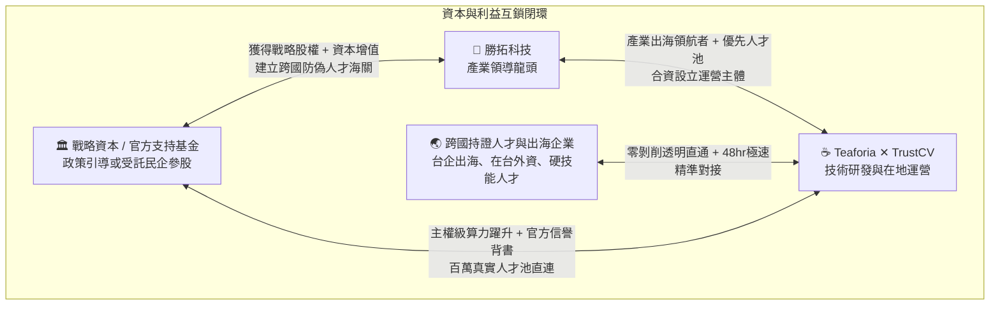

# 【四方共贏與資本架構】戰略資本協同作為護城河：多元股權閉環與公私協力架構設計

> 檔案識別：`04_FOUR_WAY_WIN_CAPITAL_STRUCTURE.md`  
> 核心受眾：產業戰略投資人、官方政策引導基金、勝拓最高決策層  
> 核心主張：**「純民營仲介難以代表超然的信任標準；引進具備公信力的政策性引導資本或其受託產業夥伴參股，能為平台建立不可撼動的跨國信用護城河！」**

---

## 一、 資本定位哲學：為什麼需要「公私協同的戰略股權」？

跨國高階人才招募最大的死穴是**「信任摩擦力」**：
* 一般民營招聘平台（如 104、LinkedIn 或私營獵頭）本質上是商業營利機構，海外工程師與雇主始終對其背景審核與中立性存疑。
* 若能引進**政策性引導基金、官方專項支持創投、或具備高度產業公信力的戰略資本參股**，TrustCV 將具備如同「數位人才海關」般的超然公信力！

### 🛡️ 靈活雙軌投資架構：給予決策方最大彈性
考量到官方決策體系的審慎偏好與風險隔離需求，本案設計了**彈性雙軌入局機制**：
* **軌道 A（直接政策參股）**：由官方引導基金（如國發基金、產發署專項基金）直接認購平台合資公司之少數股權（15%~20%）。
* **軌道 B（委託公信民企/產業創投協同）**：若官方傾向低調或委外，可指定或委託具備良好政商互信之產業龍頭或合規創投基金代表出資參股，官方則提供算力額度與政策指導。

---

## 二、 四方真實利益全景圖（The Four-Way Mutual Win Matrix）



### 1. 🏛️ 戰略資本 / 政策引導方（政府引導基金或其受託機構）：
* **真實資產回報與超額資本增值**：
  * 以算力資源與專項資本換取戰略股權。未來平台在資本市場公開發行（IPO）或獲利分紅時，享有極高的投資回報率。
* **解決台灣跨產業高階技術斷層**：
  * 協助電子電機、半導體製造、軟體 AI、廠房營造與在台外資打破人才僵局，守住國家產業競爭力。
* **樹立台印實質經貿科技合作典範**：
  * 打造乾淨、合法、國際公認的台印人才數位通道，成為新南向高科技合作的亮眼里程碑。

### 2. 🏢 勝拓科技（上游發起領導方）：
* **從傳統製造/供應鏈角色躍升為「跨國產業生態領航者」**：
  * 掌握台印高階持證人才的直通渠道，在產業界樹立不可替代的戰略地位。
* **第一順位優先鎖定頂級人才池**：
  * 勝拓本業及其供應鏈聯盟享有第一時間調取通過極限審計之優秀工程師的特權，招募效率提升 300%。
* **實質高估值資產加持**：
  * 享有合資平台之核心股東權益，將業務版圖延伸至高毛利 AI SaaS 與算力經濟。

### 3. ☕ 印度 Teaforia ✕ TrustCV 團隊（技術核心）：
* **突破算力天花板**：
  * 獲取高效能專用 GPU 算力集群，模型架構從邊緣 7B 躍升至 70B+ / MoE 主權級專家大腦。
* **獲得國家與產業級信譽背書**：
  * 突破跨國新創最難克服的信任隔閡，Trust Badge 認證成為國際公認的技能驗證標章。
* **技術 IP 資本化**：
  * 研發專利與算法轉化為具備高流動性的合資公司股權。

### 4. 🌏 跨國持證專業人才與出海企業：
* **終結不良仲介剝削**：
  * 印度優質工程師與持證人員憑自身實力直接接軌台灣優質企業，免付高額抽成。
* **台灣中小企業獲得平等的國際招募實力**：
  * 即使無海外據點之中小企業，也能在 48 小時內精準招募到真實可靠的海外頂尖技術支柱。

---

## 三、 建議合資股權與治理架構（Capital & Governance Framework）

```text
               【TrustCV 國際運營控股主體 (Co., Ltd.)】
                                  │
    ┌─────────────────────────────┼─────────────────────────────┐
    ▼                             ▼                             ▼
【核心技術創始團隊】            【勝拓科技股份有限公司】        【戰略資本 / 引導基金】
 (Teaforia ✕ TrustCV)            (Sheng Tuo Tech)          (官方基金 / 受託產業資本)
    持股比例：40% ~ 45%           持股比例：35% ~ 40%           持股比例：15% ~ 20%
    (核心專利、代碼、              (產業資金、場域驗證、          (算力專案資源、引導基金、
     雙向算法、在地社群)            生態網絡、客戶通路)            政策指導、公信力背書)
```

### 🛡️ 治理保障機制：
1. **資料主權與機密隔離**：企業專屬技術規格與評估題庫 100% 留在本地，資料不出境。
2. **算力專案專款專用**：算力集群全數綁定於 TrustCV 模型推理與垂直微調，接受專業第三方審計。
3. **清晰的資本退場與增值路徑**：預計在第 3~4 年啟動公開發行程序，投資方可彈性選擇持續分紅或於資本市場獲利了結。
