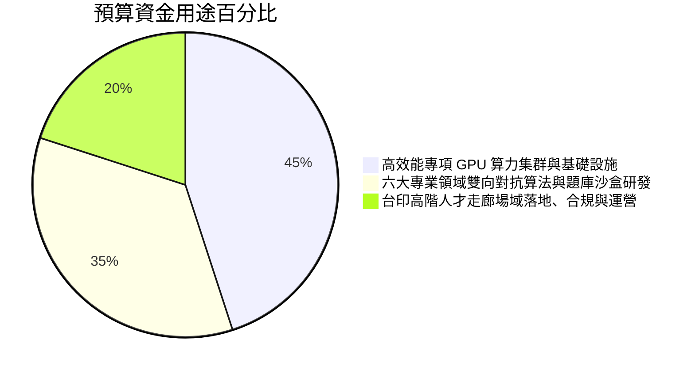

# 【投資訴求、算力調度與治理機制】預算配置、技術查核點與風控防線

> 檔案識別：`06_INVESTMENT_ASK_AND_GOVERNANCE.md`  
> 核心受眾：專案審查委員會、政策性基金決策者、戰略投資合規稽核團隊  
> 核心主張：**「每一分錢都花在硬核算力與跨國真實履約上；建立客觀量化、階段撥付、第三方盲測背書的風控閉環。」**

---

## 一、 本次專案資源爭取訴求（The Ask Overview）

為建構具備國際公信力之「高參量 AI 雙向技能真理中樞」，勝拓科技聯合印度 Teaforia ✕ TrustCV 團隊，正式提出總規模為**新台幣 4,500 萬元（提供兩段式彈性方案）**之戰略資本與算力支援申請：

### 🎯 兩段式投資規模配置方案：

| 方案等級 | 總預算規模 | 出資與算力配置結構 | 預期達成成效與算力等級 |
| :---: | :---: | :--- | :--- |
| **旗艦標竿方案<br>(推薦首選)** | **NT$ 4,500 萬** | • **算力資源折抵/專項基金**：NT$ 2,000 萬<br>• **研發與產業推廣配合款**：NT$ 1,500 萬<br>• **民間配合款（勝拓自籌）**：NT$ 1,000 萬 | • 部署 **70B+ / MoE 專家模型集群**。<br>• 支援每秒 500 場高併發雙向極限多輪抗辯。<br>• 12 個月內完成 10 萬名海外持證人才納管與 1,000 人成功對接。 |
| **快速驗證方案<br>(穩健啟動)** | **NT$ 2,500 萬** | • **算力資源折抵**：NT$ 1,200 萬<br>• **研發配合款**：NT$ 800 萬<br>• **民間配合款（勝拓自籌）**：NT$ 500 萬 | • 部署 70B 密集模型推論與垂直微調。<br>• 支援每秒 200 場對談。<br>• 12 個月內完成 5 萬人才納管與 500 人精準對接。 |

---

## 二、 預算資金分配與使用結構（Fund Allocation）

以旗艦方案（4,500 萬元）為例，資金嚴格對應核心資產與技術落地：



1. **45%（NT$ 2,025 萬）—— 高效能專項 GPU 算力集群調度與硬體部署**：
   * 專項配發高效能 GPU 伺服器集群（或租賃國家高速網路中心 NCHC / 台灣本地合規機房）。
   * 涵蓋：70B+ 模型 LoRA/全參數垂直微調、128K 超長上下文推論加速（vLLM / TensorRT-LLM）。
2. **35%（NT$ 1,575 萬）—— 六大專業領域雙向對抗算法與即時沙盒研發**：
   * 研發覆蓋半導體、電子硬體、軟體 AI、廠房營造、國際商務與專業執照的「多輪矛盾探針」。
   * 建置 IC 驗證、代碼編譯、電路圖讀取之「即時代碼沙盒 (Sandbox)」。
   * 研發企業職缺真實性與薪資合規性探針模型。
3. **20%（NT$ 900 萬）—— 台印科技走廊在地營運、資安合規與生態推廣**：
   * 印度核心科技城市頂尖工程師社群拓展與動態 CV 託管推廣。
   * 台灣出海企業、在台外資與產業夥伴之試用對接與系統導入。
   * 跨境資料傳輸法律架構與 ISO 27001 / SOC 2 資安合規認證。

---

## 三、 四大硬核結案查核點（Rigorous KPIs & Milestones）

```text
【Q1：第 3 個月】算力集群就位 ➔ 70B 基準模型調優完成，首字推論延遲 TTFT < 300ms
       ⬇️
【Q2：第 6 個月】雙向對抗 Beta 上線 ➔ 50,000 名高階人才託管動態履歷，30 家企業封測
       ⬇️
【Q3：第 9 個月】第三方客觀極限盲測 ➔ 100 組深度假履歷抗辯測試，破綻捕捉率 ≥ 95%
       ⬇️
【Q4：第 12 個月】全面自體造血與商業結案 ➔ 10 萬人才、150 家企業、營收達 NT$ 2,500 萬
```

### 📋 查核指標詳情表：

| 里程碑節點 | 技術查核指標 (Technical Deliverables) | 產業與商業指標 (Business KPIs) | 驗收證明文件 |
| :---: | :--- | :--- | :--- |
| **M1（第 3 個月）** | • 完成 GPU 集群配置與 70B 模型在地部署。<br>• 雙向推論延遲（TTFT）≤ 300 毫秒。 | • 召開首場產業生態高階招募閉門會。<br>• 完成合資公司設立與戰略持股協議簽署。 | • 系統架構部署驗收報告<br>• 公司設立證明與股東名冊 |
| **M2（第 6 個月）** | • 雙向拷問引擎與動態 CV 免費託管功能上線。<br>• 整合六大多元領域專業除錯沙盒。 | • 註冊託管高階持證人才 ≥ 50,000 人。<br>• 導入測試之台灣與在台外資企業 ≥ 30 家。 | • 平台在線即時數據看板<br>• 30 家企業試用回饋問卷 |
| **M3（第 9 個月）** | • **極限盲測防偽抗辯驗證**：針對 100 組以先進 AI 生成之高難度假履歷，**破綻捕捉率達到 95% 以上**！ | • 平台促成跨國精準對接人次 ≥ 300 人。<br>• 獲取至少 10 家中大型企業付費採用意向書。 | • 第三方公正機構（資策會/工研院等）盲測驗收證書<br>• 企業意向合約書 |
| **M4（第 12 個月）** | • 全平台正式商業化營運，支援自動化跨境薪酬與合規審計。 | • 託管人才庫 ≥ 100,000 人。<br>• 付費企業 ≥ 150 家，成功對接 ≥ 1,000 人。<br>• 平台年度現金流入 ≥ NT$ 2,500 萬元。 | • 會計師財務查核簽證報告<br>• 平台年度營運白皮書 |

---

## 四、 官方與投資方風控防線（Risk Mitigation）

1. **資料主權不出境**：企業專屬技術規格與評估題庫 100% 儲存於境內伺服器，嚴禁上傳境外商業雲端。
2. **里程碑分期撥付制**：資金採「30% - 30% - 40%」三階段撥付，每階段通過客觀指標查核方得撥付下一期，零爛尾風險。
3. **退場機制與技術自主**：所有微調模型權重與軟體 IP 歸屬於合資公司，投資方享有完整清算與監督權益。
